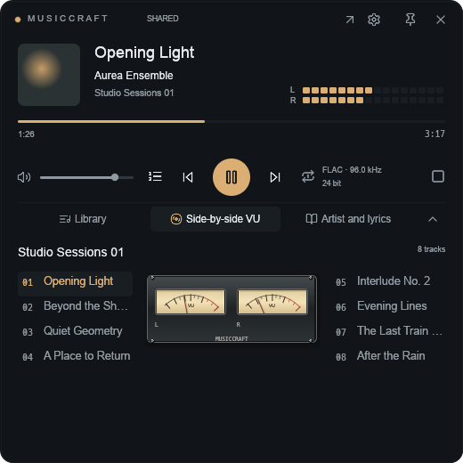
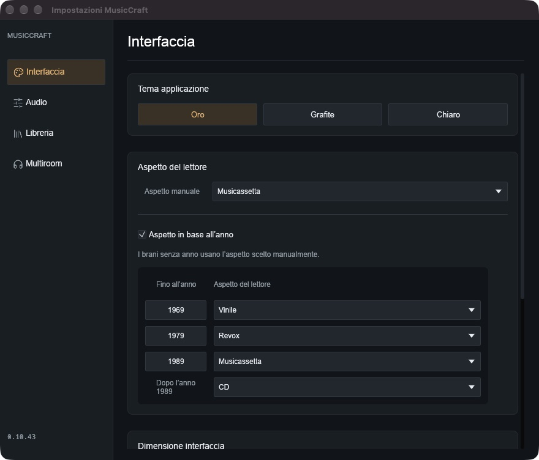

# MusicCraft

A native Rust music player for local folders, mounted NAS libraries and FTP/FTPS sources. A compact player, faceted library browser and album view keep a large personal collection close at hand.

**Independent project · macOS and Android previews · MIT source license.** MusicCraft is not an official ArtCraft application. Public repository preparation does not imply acceptance into any software suite.

## Experimental releases

- [Desktop 0.10.49 for Apple silicon macOS](https://github.com/ckiikc/musiccraft/releases/tag/v0.10.49): ad-hoc signed, not notarized; optional LMS runtime excluded.
- [Android 0.3.0 test APK](https://github.com/ckiikc/musiccraft/releases/tag/android-v0.3.0): Android 8/API 26 or newer, local debug build; no Play Store release. Android source and build instructions are in [android/](android/).

Verify each downloaded package against its release's `SHA256SUMS.txt`. MusicCraft remains an independent project; [ArtCraft community consideration](https://github.com/storytold/craft-launcher/issues/1247) is pending.



## New desktop and Android companion

Desktop 0.10.49 opens music files delivered by Finder into an ordered listening selection, supports warm/cold Open Documents events, and declares supported audio formats for Open With. Multiple-file opening selects sequential playback and clears repeat-one so the next track can advance.

The new MusicCraft Android source is discovered automatically on the local network. Pair with a four-digit code and approve the request on the phone; subsequent HTTPS reads verify the phone's identity. Each installation generates its own credentials. The Android app provides a read-only music server and pauses sharing while it plays audio locally. See [the sharing guide](docs/SHARING.md).

Android 0.3.0 separates **Cerca**, **Playlist** and a standalone **Player** with portrait and landscape layouts. Saved playlists, editable dynamic mixes, local ratings/listening history, queue editing and paused restoration of queue/position are included. Dynamic mixes choose songs, albums or artists using metadata, ratings and listening criteria; stopping additions preserves the existing queue. These are local MusicCraft statistics, not imported LMS data. Android Auto browsing and background playback use the same Media3 service.



## Listening and library

- Full library and compact player, with independent remembered window sizes.
- Faceted artist, album and folder filters; source isolation and search.
- Sequential playback, shuffled tracks and shuffled albums. The track shuffle cycle persists across restarts.
- Gapless preparation, selectable output devices and shared/exclusive output modes on macOS.
- Optional native sample-rate switching, integer PCM path and ReplayGain controls. Device/driver support is required; unsupported exclusive configurations report an error.
- FTP/FTPS sources with incremental synchronization, background tag indexing, bounded metadata reads and optional rediscovery when a phone changes its LAN address.
- Embedded artwork, folder artwork and optional online cover lookup. Optional saving of missing artwork never replaces an existing cover.
- Artist biographies and plain or synchronized lyrics when a provider has a suitable result.
- Six persistent player visuals: vinyl, CD, cassette, reel-to-reel, stacked VU meters and side-by-side VU meters. Analog needles visualize existing peak telemetry; they are not a calibrated VU instrument.
- Independent native settings and artwork windows, remembered geometry, and front/back/booklet image browsing.
- Interface and built-in help in 23 languages; translations still need editorial review.
- Original-file HTTP sharing and control of an external Lyrion Music Server for compatible players such as piCorePlayer.

There is no universal guarantee of bit-perfect hardware output or of correct results from every metadata provider. The source includes tests of PCM handling and output-format selection; an end-to-end DAC measurement is a separate hardware test.

## Build on macOS

The current build has been checked on Apple silicon with Rust **1.97.1** and Xcode Command Line Tools. Intel macOS, Windows and Linux need separate validation.

From the source directory, build with:

~~~sh
cargo run --release --locked -j 2
~~~

To run without touching your normal library or settings:

```sh
cargo run --locked -j 2 -- --data-dir /private/tmp/musiccraft-demo
```

The development-only visual fixtures use synthetic metadata and require an explicit isolated directory:

```sh
cargo run --locked -j 2 -- --data-dir /private/tmp/musiccraft-preview --ui-preview mini-vinyl --test-seconds 120
```

## Package an experimental app

```sh
scripts/package-macos.sh release
```

This produces `dist/MusicCraft.app`, without a bundled LMS runtime. The app has an ad-hoc signature for local development and is **not notarized**. No installer or application is installed automatically. [Packaging and release status](docs/RELEASING.md) explains the remaining distribution work.

The integrated LMS controller is included in the Rust source, but the third-party runtime is excluded from the default package. Use an external LMS with the standard package. A separate, explicitly requested local-use recipe is documented in [multiroom](docs/MULTIROOM.md); its output is not a cleared public redistribution bundle.

## Configure a phone or NAS

For the MusicCraft Android companion, enable **⋮ → Condividi con il computer** on the phone. On the Mac choose **Add source → MusicCraft Android**, select the discovered phone and enter the code, then authorize on the phone. No separate FTP app is needed.


Add a mounted folder as a local source, or enter the FTP/FTPS host, port and root directory in the network settings. Enter credentials in the app; do not embed them in a URL. On macOS, remembered FTP passwords use Keychain. An update of an ad-hoc-signed development app may require a new Keychain consent.

Automatic synchronization checks reachable sources approximately every two minutes and periodically audits all folders. Metadata indexing runs separately and pauses for audio transfers and scans. Its first pass is gradual; completed tag reads are journaled and survive a restart. Changed tags at an already-indexed, unchanged URL do not yet trigger a full automatic reread.

The public application uses the stable identity `io.github.ckiikc.musiccraft`
and a separate `~/Library/Application Support/MusicCraft/` profile. FTP passwords
use the `io.github.ckiikc.musiccraft.ftp` Keychain service. It starts with an empty
library and no configured network sources. The earlier 0.10.37 source-review
snapshot used a placeholder identity; it had no published binary release.
The private development app's older profile is not imported automatically.

## Privacy and external services

Music files stay on your configured devices. Online cover, biography and lyrics lookups send the relevant artist/album/title queries to their providers. They can be unavailable, rate-limited or incorrect. Retrieved media, biographies and lyrics are not project assets and retain their providers' attribution and applicable terms.

FTP without TLS exposes credentials and traffic on the network; choose FTPS or a network you trust. Optional phone rediscovery probes only bounded connected private networks and the configured port. LAN music sharing is off by default, uses a session token, and is intended for a private network; do not expose its port to the Internet. See [security](SECURITY.md).

## Development

```sh
cargo fmt --check
cargo clippy --locked --all-targets -j 2 -- -D warnings
cargo test --locked -j 2
python3 scripts/check-publication.py
python3 scripts/test_app_uuid.py
python3 scripts/test_document_types.py
```

The FTP integration harness creates synthetic audio and authenticated loopback servers. It needs Python, `pyftpdlib` and `ffmpeg`; it does not use your saved sources:

```sh
python3 -m venv .venv
.venv/bin/python -m pip install -r scripts/requirements-test.txt
.venv/bin/python scripts/test_ftp.py
```

Tests marked ignored need explicit network, audio-device, private-library or multiroom prerequisites. Do not run all ignored tests indiscriminately. See [validation](docs/VALIDATION.md), [architecture](docs/ARCHITECTURE.md) and [contributing](CONTRIBUTING.md).

## License and artwork

Project source is licensed under [MIT](LICENSE). Original project artwork and synthetic visual fixtures are described in [ATTRIBUTION.md](ATTRIBUTION.md). Lucide interface icons retain their upstream notices. System fonts are loaded locally and are not bundled. Third-party dependencies and the optional LMS component are documented in [THIRD_PARTY.md](THIRD_PARTY.md).

Maintained by [@ckiikc](https://github.com/ckiikc). Community-app consideration is tracked in [ArtCraft Launcher #1247](https://github.com/storytold/craft-launcher/issues/1247).
